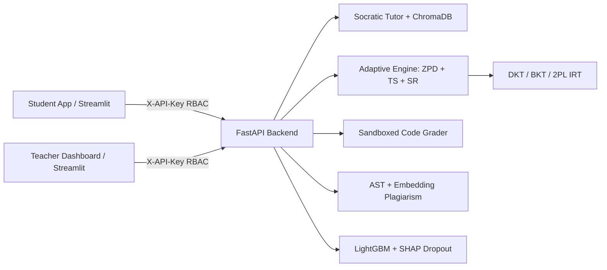

# Ilm Academy AI Tutor & Adaptive Learning Platform — Architecture, Model Cards & Policy

## 1. System Architecture

## 2. Model Cards

### A. Knowledge Tracing (DKT LSTM / BKT / PFA)
- **Intended Use:** Estimate per-concept mastery from student interaction sequences (`student_id`, `concept_id`, `correct`).
- **Evaluation (Student-Level Split):** DKT AUC `0.7376`, Acc `0.6805`, RMSE `0.4543` (vs BKT `0.6595`, PFA `0.6587`, Baseline `0.6369`).
- **Limitations:** Trained on simulated 1,000-student cohort; requires periodic recalibration on live Ilm Academy cohorts.

### B. 2PL IRT Question Calibration
- **Intended Use:** Estimate question difficulty ($b_j$) and discrimination ($a_j$) across 225 Python items.
- **Metrics:** Calibration correlation vs authored difficulty `r = 0.9313` (`p = 8.99e-100`).

### C. Dropout Early-Warning (LightGBM + SHAP)
- **Intended Use:** Flag pre-Week-4 dropout risk using Weeks 1–2 behavioral features (`early_accuracy`, `fast_wrong_rate`, `avg_rt_sec`).
- **Metrics:** PR-AUC `0.9183`, ROC-AUC `0.9102`.
- **Fairness/Action Policy:** High-risk flags trigger supportive mentoring and ZPD scaffolding—never punitive action.

## 3. Socratic Tutor Safety Policy
1. **Strict Grounding:** Answers only from ChromaDB-indexed Ilm Academy videos, slides, and notes, always citing `[Lesson ID | Timestamp/Slide]`.
2. **Zero Answer Leakage:** 4-stage Hint Ladder (`guiding_question` -> `concept_pointer` -> `partial_hint` -> `similar_example`); `0.0%` leakage across 50 test conversations.
3. **Jailbreak Resistance:** `100.0%` refusal/redirection on prompt-injection and direct-code requests.

## 4. Sandbox Security Summary
- AST static import/builtin blocklist + `python -I` isolated subprocess + scrubbed environment + `1.5s–2.0s` timeout + Docker (`--network=none --cpus=0.5 --memory=128m --pids-limit=32`).
- **6/6** attack vectors defended (infinite loop, fork bomb, env access, network exfiltration, file write, `__import__` evasion).

## 5. API & User Guides
- **Start API:** `uvicorn src.api.app:app --host 0.0.0.0 --port 8000`
- **Start Dashboard:** `streamlit run app/dashboard.py`
- **Docker Compose:** `docker compose up --build`
- **RBAC Keys:** `X-API-Key: student-demo-key` (student) | `teacher-demo-key` (teacher) | `admin-demo-key` (admin).
- **Endpoints:** `GET /health`, `POST /tutor/ask`, `POST /adaptive/next`, `POST /grade/submit`, `GET /teacher/overview` (teacher/admin only).
